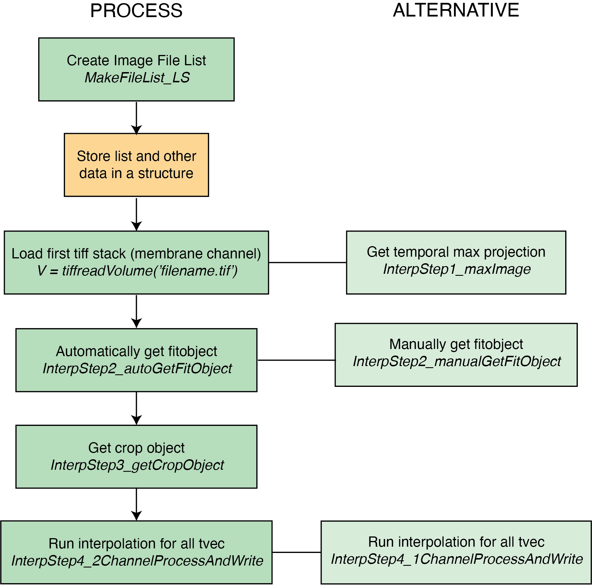

## Light Sheet Decurving Flowchart


## Main Process:

1. Create image file list.
    - Navigate in Matlab to the folder location where the movie images are stored. This will be used as the path in the MakeFileList function.
    ```matlab
    path = cd
    [ListCh0,ListCh1] = MakeFileList_LS(path)
    ```
2. Store list and other data in a structure.
    - Important data to save would be at a minimum the ImageFileList, Source, SecPerFrame. Other data can include start and end of GBE, pixel size in microns, processed movies, etc.
    - Save the data structure in the Source folder.

    ```matlab
    data.Source = path
    data.ImageFileList = imageFileList
    data.SecPerFrame = 1
    save('data','data')
    ```
4. Load first tiff stack (membrane channel).
   - Save the first tiff volume as 'V', using the membrane channel for better edge detection.
   ```matlab
   V = tiffReadVolume('filename.tif')
   ```
9. Automatically get fitobject.
   - Run the automatic fit finding function which will fit the curvature of the surface to a polynomial
   ```matlab
   [fitobject,Verts,X,Y,Z,Vinterp] = InterpStep2_autoGetFitObject(V)
   ```
   - Check the interpolated image afterwards to look for artifacts in the image. If there are artifacts in the top layers, you may need to increases the number of layers set to False in the subfunction 'findSurfaceVerts'.
5. Get crop object.
   - Give cropping parameters to remove the all black regions that don't contain tissue.
   - The function will ask for the cropping values in this form: `[row min, row max, col min, col max, z min, z max]`
   ```matlab
   [crop_obj] = InterpStep3_getCropObject(Vinterp)
   ```
6. Run interpolation for all frames.
   - Run the decurving for all time points. Inputs to the function are the the original file lists, the crop_obj and fitobject, as well as the time vector (given in frames, i.e. [1:20]), the savepath and readpath. The readpath should be the original deskewed image source, and the savepath should be a new folder (i.e. Processed_Images).
   ```matlab
   [NewImageListCh0,NewImageListCh1] = InterpStep4_2ChannelProcessAndWrite(ListCh0,ListCh1,crop_obj,fitobject,[1:20],cd,data.Source)
   ```


## Alternative Process:

1. Get temporal max projection.
   - Create a temporal maximum projection of the image data, producing a new image where each pixel's intensity represents the maximum intensity of that pixel across the entire time series.
   - This step is most likely unnecessary, as it seeems that the embryo does not move during imaging. However, if this changes, then a max projection might be useful.
   - The function inputs are the original membrane file list and the time vector (given in frames, i.e. [1:20]).
   ```matlab
   [V] = InterpStep1_maxImage(ListCh0,[1:20])
   ```
2. Manually get fitobject.
   - Run the manual fit finding function, which provides a user interface for selecting points on the image, which are then used to fit a surface.
   ```matlab
   [fitobject,Verts,X,Y,Z,Vinterp] = InterpStep2_manualGetFitObject(V,[])
   ```
3. Run interpolation for all frames.
   - Run the decurving for all time points. Inputs to the function are the the original file list, the crop_obj and fitobject, as well as the savepath. The savepath should be a new folder (i.e. Processed_Images).
   ```matlab
   [NewImageListCh0] = InterpStep4_1ChannelProcessAndWrite(ListCh0,crop_obj,fitobject,cd)
   ```


# LLSM-image-processing
 
The main idea is the following: Due to the curvature of the tissue we interpolated the intensities (in the deskewed image volume) over the apical surface to get an image of the apical surface and then we shifted that surface down to interpolate the next z-layer and so on. These interpolated images give us what we can call a "flattened image volume."

Step 1) I do not believe this step is absolutely necessary so you could probably skip it or you could test whether it is worth it. What step 1 does is a temporal max projection (a mean intensity projection would probably work too). It takes the 3D images from each time point and takes the maximum intensity of each voxel. Why? We are going to be finding one interpolation surface (which is used to generate all the z-slices in the z-stack) for the entire time series. Because we were going to be finding one interpolation surface for all the time points I figured it would be best to use all the time points (a temporal intensity projection) to find the surface. However, from my experience the curvature of the tissue doesn't change over time, nor did I see any translational movement of the embryo over time (like if something were to get shifted in the x-, y-, or z-direction accidentally). Given that I didn't see either of these things you could probably just use the first time point (i.e. the first deskewed image volume) to find the surface.

Step 2) This step takes a deskewed image (either from a single time point or a using step 1 to generate a time projection) and uses it to identify x-y-z coordinates (i.e. vertices) on the apical surface. These vertices are then used to generate a  fit to the surface. Looking at my function I realize that I tried different ways to identify the surface vertices, both automatic and manual methods. The manual method involved looping through Y-Z cross-sections and drawing the surface or just adjusting the vertices of a polygon I think (I tried to make it quick and easy to do). There is another version that does automated the process but I can't remember much about what it was doing (probably involved thresholding). It is possible that if you go the automated route you could need to make some changes if your image data differs from mine. Step 2 is all about getting the "fit object", which is needed in Step 4. Step 2 also outputs the V_interp (i.e. the flattened image volume for the input deskewed volume). The V_interp will be used in Step 3.

Step 3) The resulting "flattened" image volume (i.e.  V_interp) has a lot of black regions (zero value intensity due to the interpolation surface being outside the deskewed image volume. Especially as you go deeper in z, the amount of non-zero pixels gets smaller and smaller until you only capture a few cells. This means there is a lot of unuseful space where we don't capture the deeper parts of some of the tissue. Thus Step 3 is all about cropping a 3D cuboid that captures a "useful" part of the volume. The function takes V_interp from Step 2 and gives counts of how many zero pixels summed over z from the middle row and middle column you have. It then becomes your choice of how much to crop by inputting where to start and stop for x, y and z ranges. You probably don't want to only crop a region where there are no zeros because it will likely be very small.

Step 4) This function takes the "fitobject" (from step 2) and "cropobject" (from step 3) and loops over all the deskewed image volumes and does the interpolation and cropping and writes to new tiff stacks. There is a single channel version of this and two-channel version. 
